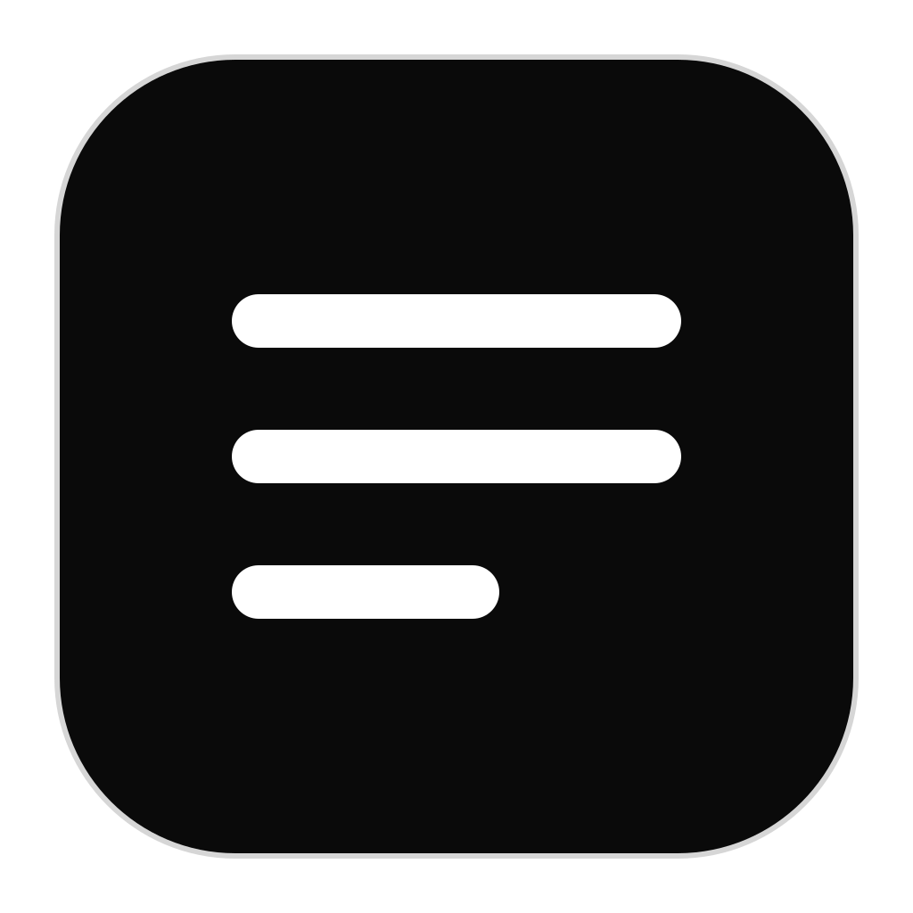
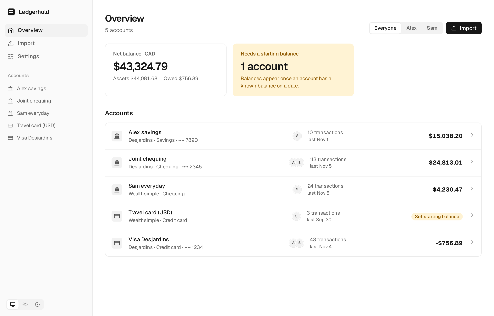
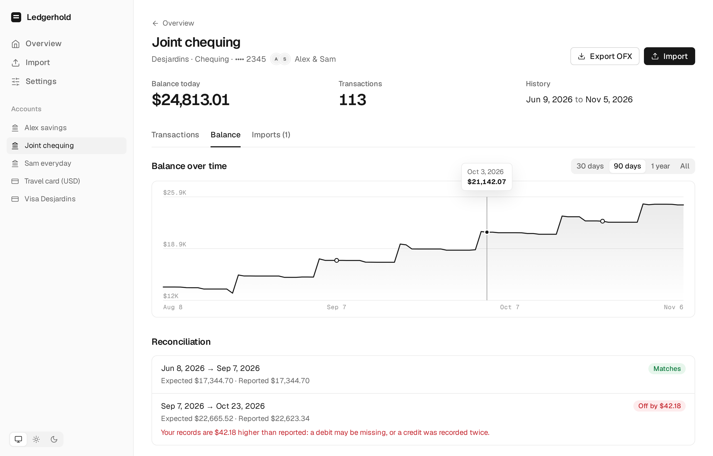
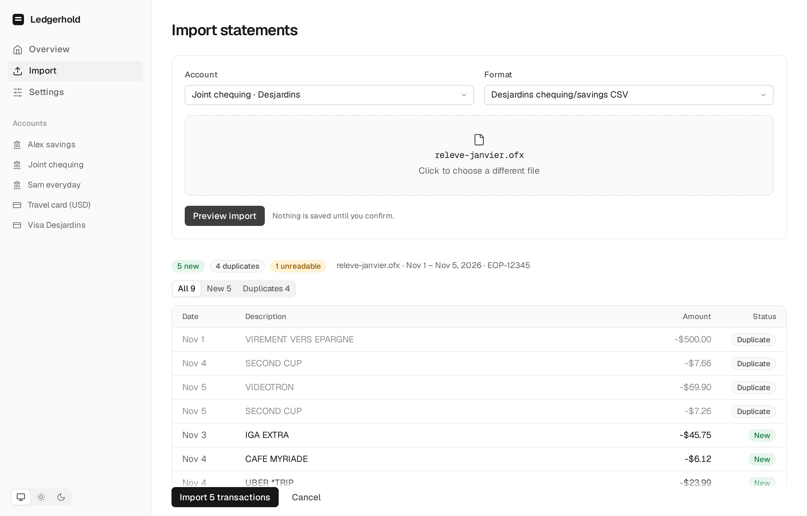

<div align="center">

# Ledgerhold
##### Your household's bank statements, in one place




</div>

Ledgerhold imports bank statements from several banks into one local database, skips transactions you already have,
tracks every account's balance from a known starting point, and exports OFX for any date range, such as the 1st to the
last day of each month, for your budgeting app. It replaces [bank-to-ofx](https://github.com/Dwarf1er/bank-to-ofx) and
keeps its parsers.

Accounts can belong to one person or be shared, so a household with joint accounts sees everything in one place. It runs
as a desktop app on Linux, macOS and Windows, as a command-line tool, or as a small self-hosted web server (Docker) that
the whole household opens in a browser.

<p align="center">
  <picture>
    <source media="(prefers-color-scheme: dark)" srcset="assets/screenshots/overview-dark.png">
    
  </picture>
</p>

## Table of Contents

<!-- mtoc-start -->

* [What's included](#whats-included)
* [Installation](#installation)
  * [Desktop app](#desktop-app)
  * [Command-line tool](#command-line-tool)
  * [Self-hosting with Docker](#self-hosting-with-docker)
  * [From source](#from-source)
* [Quickstart](#quickstart)
* [How it works](#how-it-works)
  * [Duplicates](#duplicates)
  * [Starting balances and reconciliation](#starting-balances-and-reconciliation)
  * [Exporting OFX](#exporting-ofx)
* [Supported statements](#supported-statements)
* [Command line](#command-line)
* [Self-hosting in detail](#self-hosting-in-detail)
  * [Configuration](#configuration)
  * [HTTPS and reverse proxies](#https-and-reverse-proxies)
  * [Backups and updates](#backups-and-updates)
  * [Security model](#security-model)
* [Where your data lives](#where-your-data-lives)
* [Building from source](#building-from-source)
  * [Releasing](#releasing)
* [Acknowledgements](#acknowledgements)
* [License](#license)

<!-- mtoc-end -->

## What's included

| | |
| --- | --- |
| **Desktop app** | The full interface as a native window (Tauri), with file pickers and folder export. Linux, macOS and Windows. |
| **`ledgerhold`** | The same features on the command line: import, undo, balances, reconcile, export. A single self-contained file. |
| **`ledgerhold-server`** | The same interface in a browser, protected by one shared household password you choose on first run. Ships as a 54 MB Docker image (amd64 and arm64). |

All three read and write the same kind of SQLite file, and the desktop app and the CLI share one by default.

<p align="center">
  <picture>
    <source media="(prefers-color-scheme: dark)" srcset="assets/screenshots/balance-dark.png">
    
  </picture>
  <picture>
    <source media="(prefers-color-scheme: dark)" srcset="assets/screenshots/import-dark.png">
    
  </picture>
</p>

## Installation

### Desktop app

Download the installer for your platform from the [Releases](../../releases) page.

| Platform | Installer |
| --- | --- |
| Linux x64 | `Ledgerhold_VERSION_amd64.deb`, `Ledgerhold-VERSION-1.x86_64.rpm`, `Ledgerhold_VERSION_amd64.AppImage` |
| Linux arm64 | `Ledgerhold_VERSION_arm64.deb`, `Ledgerhold-VERSION-1.aarch64.rpm` |
| macOS Apple silicon / Intel | `Ledgerhold_VERSION_aarch64.dmg`, `Ledgerhold_VERSION_x64.dmg` |
| Windows x64 | `Ledgerhold_VERSION_x64_en-US.msi`, `Ledgerhold_VERSION_x64-setup.exe` |

Verify with `sha256sum -c SHA256SUMS`. Then:

```bash
sudo apt install ./Ledgerhold_VERSION_amd64.deb      # Debian, Ubuntu
sudo dnf install ./Ledgerhold-VERSION-1.x86_64.rpm   # Fedora
chmod +x Ledgerhold_VERSION_amd64.AppImage && ./Ledgerhold_VERSION_amd64.AppImage   # anywhere
```

On **Arch Linux**, `packaging/aur/PKGBUILD` installs the desktop app and the CLI from the release files (`ledgerhold-bin`):

```bash
cd packaging/aur && makepkg -si
```

A few things to know:

* **The installers are not code-signed.** macOS Gatekeeper will quarantine the download (the app is signed ad hoc, not
  notarized): after copying it to Applications, run `xattr -dr com.apple.quarantine /Applications/Ledgerhold.app`.
  Windows SmartScreen will warn too: choose *More info*, then *Run anyway*.
* **macOS** needs version 12 or later. **Windows** needs the WebView2 runtime, which the installer fetches if it is missing.
* **Linux** needs `webkit2gtk-4.1` and `gtk3`; the `.deb` and `.rpm` declare them.
* **macOS and Windows are newer than Linux.** CI builds and smoke-tests every installer on real runners, but the Linux
  builds are the ones used day to day. Expect rough edges elsewhere and please report them.

### Command-line tool

Each release has a `ledgerhold-cli-VERSION-PLATFORM` archive (`.tar.gz`, or `.zip` on Windows) holding the `ledgerhold`
binary. Unpack it somewhere on your `PATH`.

### Self-hosting with Docker

```bash
git clone https://github.com/Dwarf1er/ledgerhold.git
cd ledgerhold
docker compose up -d
docker compose logs ledgerhold     # prints a one-time setup code
```

Open [http://localhost:3000](http://localhost:3000), enter the setup code, and choose the household password. That's
the whole setup: there's no `.env` file to write and no password sitting in your configuration. The first build compiles
the server and takes a few minutes. Each release also publishes a multi-arch image:

```bash
docker run -d --name ledgerhold -p 3000:3000 -e TZ=America/Toronto \
  -v ledgerhold-data:/data ghcr.io/dwarf1er/ledgerhold:latest
docker logs ledgerhold             # the setup code
```

Until a password is chosen the server shows nothing but the setup screen, and only someone who can read its log can
finish it. See [Self-hosting in detail](#self-hosting-in-detail) for HTTPS, backups, a forgotten password and the full
list of settings.

### From source

Needs Rust and Node (`mise install` sets both up from `mise.toml`) and, on Linux, the Tauri system libraries.

```bash
git clone https://github.com/Dwarf1er/ledgerhold.git
cd ledgerhold
./install.sh
```

This builds the CLI and the desktop app and installs them for the current user without root: the binaries go to
`~/.local/bin`, with an application-menu entry and icon. `./install.sh -u` removes them and never touches your data. On
macOS and Windows use the installers above, or `npm ci && npm run tauri build` (the bundles end up under
`target/release/bundle`).

System libraries for the desktop app:

```bash
sudo pacman -S webkit2gtk-4.1 gtk3 librsvg libayatana-appindicator                          # Arch
sudo apt install libwebkit2gtk-4.1-dev libgtk-3-dev librsvg2-dev libayatana-appindicator3-dev   # Debian, Ubuntu
```

## Quickstart

**1. Describe your household.** In **Settings**, add the people, then a bank (with its OFX bank ID if your budgeting app
asks for one), then each account. Give an account more than one owner for a joint account. Enter the account or card
number as it is printed on statements: a file that contains several accounts is matched to the right one by it.

**2. Import a statement.** Choose **Import**, pick the account and the file (or drop it on the window). The preview lists
every row as *New* or *Duplicate* and anything that could not be read, with line numbers. Nothing is saved until you
confirm, and each import can be undone as a whole from the account's **Imports** tab.

**3. Tell it a balance.** On the account's **Balance** tab, enter what the balance was at the end of some day, for
example from a statement. From then on Ledgerhold knows the balance on every day, and the overview shows a net total.

**4. Export.** Choose **Export OFX** on an account: one month, a custom range, or every month at once. You get one file
per account, ready to import into your budgeting app.

## How it works

### Duplicates

Statements overlap, and the same transactions arrive in different formats. When you import, each row is compared with
what you already have:

* A row with a bank-assigned id (OFX files have one) is a duplicate if that id is known.
* Otherwise rows are matched on account, date, amount and description. If a file has three identical coffees on one day
  and you already have two, only the third is new, whatever order the rows come in.
* A CSV imported first and the OFX of the same account later are recognised as the same transactions, and so is
  re-importing a file Ledgerhold exported.

### Starting balances and reconciliation

A *starting balance* (an anchor) says: "at the end of this day, the balance was this much". Transactions on that day are
already included. The balance on any other day is the nearest anchor plus or minus the transactions in between, so it is
always consistent with what you imported.

Add more anchors over time, for instance from each statement. Ledgerhold compares each pair against the transactions
between them and tells you where they disagree and by how much: *"Your records are $42.18 higher than reported: a debit
may be missing, or a credit was recorded twice."* Credit cards work the same way, with money owed shown as a negative
balance.

### Exporting OFX

Exports use the real bank ID and account type, escape special characters, cover exactly the dates you asked for and
end with the account's balance on the last day. Each transaction keeps a stable id, so exporting the same range twice
gives identical files and your budgeting app can recognise repeats.

## Supported statements

| Format | Parser | Notes |
| --- | --- | --- |
| Desjardins chequing / savings CSV | `desjardins` | Headerless. Several accounts per file are split by account number. |
| Desjardins Visa PDF | `desjardins-credit` | Desjardins offers no CSV for cards. Text is read from the PDF, so check the first import against your statement. |
| Wealthsimple chequing CSV | `wealthsimple` | |
| Wealthsimple credit card CSV | `wealthsimple-credit` | Debit or credit comes from the row type (payment, refund, ...), not the sign. A file with several currencies is split by currency. |
| OFX, QFX, QBO | `ofx` | Any bank. SGML and XML, several accounts per file. |

Rows that cannot be understood are reported with their line numbers instead of being skipped silently. New formats are
a parser in `crates/parsers/src/` implementing `StatementParser`, with a fixture under `fixtures/`.

## Command line

```bash
ledgerhold person add Alex
ledgerhold institution add Desjardins --bank-id 815
ledgerhold account add --institution Desjardins --name Joint --kind checking --number EOP-12345 --owner Alex --owner Sam
ledgerhold anchor set Joint 2026-01-01 700.00
ledgerhold import Joint releve.csv --parser desjardins [--dry-run]
ledgerhold balance Joint --on 2026-01-31
ledgerhold reconcile Joint
ledgerhold export Joint --month 2026-01 -o ~/budget          # or --from/--to, or --all-months
```

Also: `transactions`, `batches`, `undo`, `account list`, `parsers`. Formats are detected for OFX/QFX/QBO files; for CSV
and PDF pass `--parser`. `--db FILE` (or `LEDGERHOLD_DB`) picks another database.

## Self-hosting in detail

### Configuration

Set these as environment variables (in `.env` for Docker Compose):

| Variable | Description |
| --- | --- |
| `LEDGERHOLD_PASSWORD` | Optional. Sets the household password from the environment (8 or more characters) instead of the browser setup. The web UI then can't change it. |
| `TZ` | Your timezone, e.g. `America/Toronto`, so "today" and month boundaries are right. Defaults to `UTC`. |
| `LEDGERHOLD_PORT` | Host port for Docker Compose. Defaults to `3000`. |
| `LEDGERHOLD_ALLOWED_ORIGINS` | Extra comma-separated origins allowed to use the API, for a proxy that rewrites the `Host` header, e.g. `https://ledger.example.com`. |
| `LEDGERHOLD_SECRET` | Key used to sign sign-ins. Generated and kept beside the database by default. |
| `LEDGERHOLD_ALLOW_NO_AUTH` | Set to `1` to serve with no password at all, only if something in front handles authentication. |
| `LEDGERHOLD_LISTEN`, `LEDGERHOLD_DB`, `LEDGERHOLD_STATIC` | Address, database file and web UI folder. The image sets sensible values. |

Without Docker, build `ledgerhold-server` (`cargo build --release -p ledgerhold-server`), build the UI (`npm --prefix ui
ci && npm --prefix ui run build`) and run it with `LEDGERHOLD_STATIC=ui/dist`. `ledgerhold-server --help` lists the settings.

### The household password

The first time the server starts on a network address with no password configured, it enters **setup mode**: it prints a
random one-time code in its log (`docker compose logs ledgerhold`) and shows only a setup screen. Enter the code and
choose a password (8 or more characters) and you're signed in. The code stops working as soon as it's used and changes
on every restart.

The password is stored as a salted argon2 hash in the data volume (`password.hash`), never in plain text. Change it
under **Settings → Security**; changing it signs everyone else out.

**Forgot it?** Forget the stored password, restart, and go through setup again. Your data isn't touched:

```bash
docker compose exec ledgerhold ledgerhold-server reset-password
docker compose restart ledgerhold
docker compose logs ledgerhold     # the new setup code
```

Setting `LEDGERHOLD_PASSWORD` skips setup and takes precedence. Running on `127.0.0.1` only (no Docker) needs no password.

### HTTPS and reverse proxies

On your home network plain HTTP is fine. Anywhere else, put it behind a reverse proxy that terminates HTTPS. The proxy
must pass the original `Host` header and `X-Forwarded-Proto`; the latter marks the sign-in cookie `Secure`. With Caddy:

```
ledger.example.com {
    reverse_proxy localhost:3000
}
```

With nginx, add `proxy_set_header Host $host;`, `proxy_set_header X-Forwarded-Proto $scheme;` and
`client_max_body_size 25m;` to the `location`.

### Backups and updates

Everything is in the `ledgerhold-data` volume: the SQLite database, plus `password.hash` and `session.key`. To back it
up, stop the container, copy the volume's files, and start it again (a backup contains your password hash, so keep it
private):

```bash
docker compose stop
docker run --rm -v ledgerhold_ledgerhold-data:/data -v "$PWD":/backup alpine sh -c 'cp -a /data/. /backup/'
docker compose start
```

To update, pull and rebuild: `git pull && docker compose up -d --build`. Database changes are applied automatically at startup.

### Security model

* One shared password for the household. There are no per-person logins or roles; people are labels on accounts.
* There is no default password. Until one is chosen, the server serves nothing but the setup screen, which needs a code
  that only appears in the server log. The password is kept as a salted argon2 hash, and setup attempts are throttled
  like logins.
* Sign-ins are signed, `HttpOnly`, `SameSite=Strict` cookies that last 30 days. Failed logins are slowed down and
  limited to ten a minute.
* Writes from other websites are refused, and responses carry a strict Content-Security-Policy.
* Uploaded statements are kept in a temporary folder only until imported (and swept within about an hour if you never
  import them). Exports are kept for about an hour so you can download them.
* The container runs as a non-root user on a shell-less base image.

## Where your data lives

The desktop app and the CLI use the same file by default:

| OS | Location |
| --- | --- |
| Linux | `$XDG_DATA_HOME/ledgerhold/ledgerhold.sqlite`, normally `~/.local/share/ledgerhold/` |
| macOS | `~/Library/Application Support/ledgerhold/ledgerhold.sqlite` |
| Windows | `%LOCALAPPDATA%\ledgerhold\ledgerhold.sqlite` |

Set `LEDGERHOLD_DB` to use another file. Use one front end per database file: don't point the desktop app and a server at
the same one at the same time.

## Building from source

```bash
git clone https://github.com/Dwarf1er/ledgerhold.git
cd ledgerhold
mise install                 # Rust and Node, pinned in mise.toml
mise run test                # Rust and UI tests, plus type checks
mise run ui                  # the UI in a browser on demo data, no Tauri needed
mise run dev                 # the desktop app with hot reload
```

| Path | Purpose |
| --- | --- |
| `crates/core` | `Money` (integer cents), canonical types, duplicate detection. No I/O. |
| `crates/parsers` | One parser per bank/format, tested against goldens from the old Python tool. |
| `crates/ofx` | OFX writer and a tolerant reader (SGML and XML, cp1252, single-line files). |
| `crates/store` | SQLite schema and migrations, import and undo, balances, reconciliation. |
| `crates/app` | Service layer with JSON-friendly types, shared by every front end. |
| `crates/cli` | The `ledgerhold` command. |
| `crates/server` | The web server: sign-in, uploads, downloads, security headers. |
| `src-tauri` | The Tauri desktop shell: thin commands over `crates/app`. |
| `ui` | Svelte 5 + Vite + TypeScript, used by both the desktop app and the web server. |
| `fixtures`, `tools` | Synthetic statements and the scripts that regenerate goldens, screenshots and packaging checks. |

Conventions: money is integer minor units, and negative means money leaving the account (a card purchase is negative).
Dates are plain calendar dates. Schema changes are new numbered files in `crates/store/migrations`; never edit a shipped
one. Fixtures are synthetic, so never commit a real statement. `tools/screenshots` regenerates the screenshots above
from the UI's demo data.

To build the installers for your own OS, then smoke-test them (`package.sh` stamps the version into `Cargo.toml` and
`src-tauri/tauri.conf.json`, so use the current version or restore those two files afterwards):

```bash
scripts/package.sh linux-x64 0.1.0 dist/stage
scripts/smoke.sh dist/stage 0.1.0 linux-x64
scripts/smoke-docker.sh ledgerhold:local        # after: docker build -t ledgerhold:local .
```

### Releasing

Pushing a tag builds and publishes everything (see `.github/workflows/release.yml`):

```bash
git tag v1.0.0 && git push origin v1.0.0      # v1.0.0-rc.1 publishes a prerelease
```

The workflow tests on Linux, Windows and macOS, builds each platform's installers and CLI, smoke-tests them, pushes the
multi-arch Docker image to `ghcr.io`, and attaches everything and a `SHA256SUMS` file to a GitHub release. **Actions >
release > Run workflow** does a dry run (everything except publishing) from any branch.

After a release, bump `pkgver` in `packaging/aur/PKGBUILD`, run `updpkgsums`, and publish `ledgerhold-bin` to the AUR.

## Acknowledgements

* [Tauri](https://tauri.app/) for the desktop shell, [Svelte](https://svelte.dev/) for the interface, and
  [axum](https://github.com/tokio-rs/axum) for the server.
* [rusqlite](https://github.com/rusqlite/rusqlite) and [SQLite](https://sqlite.org/) for storage, and
  [pdf-extract](https://github.com/jrmuizel/pdf-extract) for reading statement PDFs.
* [Geist](https://vercel.com/font) by Vercel and Basement Studio, the typeface and the inspiration for the look (SIL Open
  Font License).
* [FinVault](https://github.com/finvaultapp/finvault) (MIT), whose import-preview and undo flow inspired Ledgerhold's.

## License

This software is licensed under the [MIT license](LICENSE).
